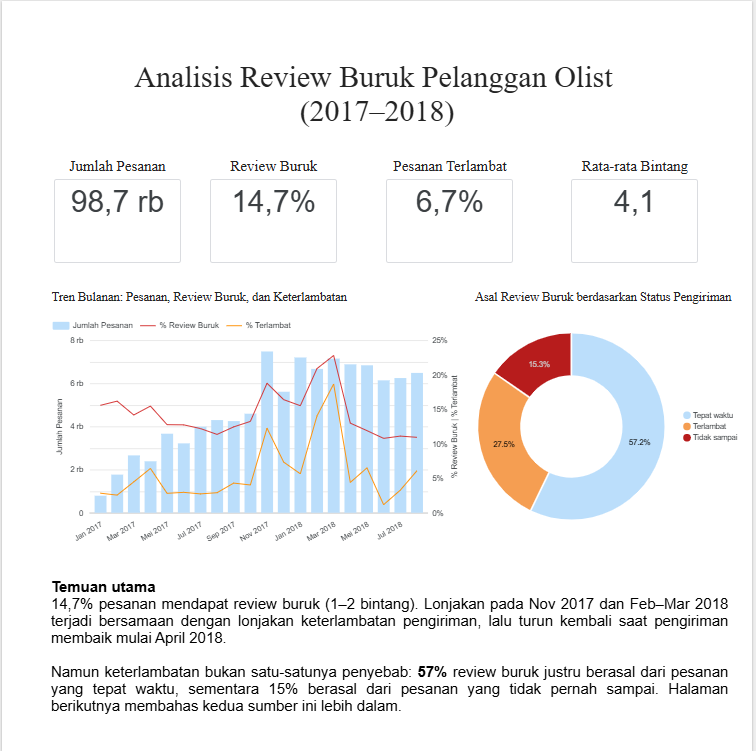

# Analisis Penyebab Review Buruk pada E-Commerce Olist

Analisis 99.441 pesanan marketplace Brazil untuk menjawab satu pertanyaan: **mengapa pelanggan memberi review buruk (1–2 bintang), dan apa yang bisa dilakukan untuk mencegahnya?**

**🔗 [Dashboard Looker Studio](https://datastudio.google.com/s/l7uoBVLNEaI)** · **📑 [Presentasi Temuan & Rekomendasi](https://docs.google.com/presentation/d/1eSYwUin7dvukItcYpUs8Yv5wiNK5qiqCDYXUNEw-Kpo/edit?usp=sharing)**



---

## Latar Belakang

Sekitar **14,7%** pesanan di Olist mendapat review 1–2 bintang. Review buruk merusak reputasi marketplace dan para seller-nya. Project ini mencari faktor penyebabnya dan menyusun rekomendasi yang bisa ditindaklanjuti.

**Rumusan masalah:**
1. Seberapa besar dan bagaimana tren review buruk dari waktu ke waktu?
2. Seberapa besar pengaruh keterlambatan pengiriman terhadap review buruk?
3. Kategori produk, region, dan seller mana yang paling sering mendapat review buruk?
4. Faktor apa lagi yang berpengaruh?

## Data

[Brazilian E-Commerce Public Dataset by Olist](https://www.kaggle.com/datasets/olistbr/brazilian-ecommerce) (Kaggle): 99.441 pesanan periode September 2016 – Oktober 2018, tersebar di 9 tabel yang saling berelasi. Analisis ini memakai 8 tabel (tabel geolocation tidak dibutuhkan).

## Tools & Alur Kerja

| Tahap | Tools | Yang dikerjakan |
|---|---|---|
| Persiapan data | Google BigQuery (SQL) | Upload 8 tabel, validasi jumlah baris, gabungkan menjadi satu tabel analisis |
| Analisis | Python (pandas, matplotlib) di Google Colab | EDA untuk menjawab rumusan masalah 1–4 |
| Visualisasi | Looker Studio | Dashboard 3 halaman untuk audiens non-teknis |
| Komunikasi | Google Slides | Presentasi temuan dan rekomendasi |

**Catatan teknis penting:** tabel barang, pembayaran, dan review punya hubungan satu-ke-banyak dengan pesanan. JOIN langsung membuat baris berlipat ganda dan total penjualan membengkak sekitar **R$680 ribu (5%)** dari nilai sebenarnya R$13,59 juta. Karena itu ketiga tabel diringkas per pesanan terlebih dahulu, sehingga tabel analisis berisi tepat **satu baris per pesanan** (lihat `sql/03_build_orders_analysis.sql`).

## Temuan Utama

Review buruk berasal dari tiga sumber utama yang bersama-sama menyumbang **58%** review buruk:

**1. Pesanan terlambat (27% review buruk)**
- Pesanan terlambat punya peluang review buruk hampir **7 kali lipat** (62,4% vs 9,3%).
- Pelanggan menilai **apakah janji tanggal ditepati**, bukan seberapa cepat barang datang. Datang lebih awal tidak menambah kepuasan, tetapi telat 1–3 hari saja sudah menaikkan review buruk menjadi 32%, dan tertahan di sekitar 80% setelah telat seminggu.
- Lonjakan review buruk pada Nov 2017 dan Feb–Mar 2018 mengikuti lonjakan keterlambatan (korelasi bulanan 0,81).
- Perbedaan review buruk antar state hampir seluruhnya disebabkan keterlambatan. Wilayah timur laut (AL, MA, SE, CE) dan RJ paling terdampak.

**2. Pesanan yang tidak pernah sampai (15% review buruk)**
- Hanya sekitar 3% pesanan, tetapi review buruknya 70–93%. Status seperti *shipped* dan *invoiced* ternyata pesanan yang macet berbulan-bulan.

**3. Pesanan multi-barang yang tidak lengkap (15% review buruk)**
- Pesanan berisi lebih dari satu barang hanya 10% dari pesanan tepat waktu, tetapi menyumbang **27%** review buruk pada kelompok itu. Pesanan dari beberapa seller punya peluang review buruk 46,9%.
- 40–56% review buruk pada pesanan multi-barang mengeluhkan barang yang tidak lengkap. Dugaan kuat: pesanan tercatat sampai saat paket pertama tiba, padahal barang lain belum diterima.

**Faktor pendukung:** kategori furnitur lebih berisiko (office_furniture 18,5%, dua kali rata-rata), sedangkan seller bermasalah hanya menyumbang 8,2% review buruk, sehingga masalahnya bersifat sistemik.

## Rekomendasi

| Rekomendasi | Masalah yang disasar | Porsi review buruk |
|---|---|---|
| Peringatan otomatis untuk pesanan yang melewati estimasi tanpa status sampai | Pesanan tidak sampai | 15% |
| Estimasi tanggal yang realistis per rute, dimulai dari timur laut dan RJ | Keterlambatan | 27% |
| Status "sampai" hanya setelah semua paket diterima, dan info pengiriman terpisah sejak awal | Multi-barang tidak lengkap | 15% |
| Standar kemasan dan deskripsi produk untuk kategori furnitur | Kategori berisiko | Kecil |
| Evaluasi 19 seller dengan review buruk minimal 20% | Seller bermasalah | 5% |

*Porsi review buruk adalah batas atas dampak, bukan perkiraan penurunan.*

## Batasan Analisis

- Data berasal dari satu marketplace pada 2016–2018, sehingga polanya bisa berbeda saat ini.
- Data tidak mencatat tanggal sampai per paket; dugaan pesanan tidak lengkap berasal dari isi komentar pelanggan.
- Deteksi keluhan memakai kata kunci bahasa Portugis, sehingga tidak semua keluhan tertangkap.
- Korelasi bulanan hanya dari 21 titik; kesimpulan tentang keterlambatan juga didukung perbandingan per pesanan.
- Sekitar 42% review buruk berasal dari pesanan 1 barang yang tepat waktu, dan penyebabnya (misalnya kualitas produk) tidak tercatat di data.

## Struktur Repository

```
├── sql/
│   ├── 01_fix_category_translation.sql   # perbaikan tabel kategori (karakter BOM)
│   ├── 02_validasi_jumlah_baris.sql      # cek 8 tabel ter-upload utuh
│   ├── 03_build_orders_analysis.sql      # tabel analisis, satu baris per pesanan
│   └── 04_build_orders_dashboard.sql     # tabel sumber dashboard Looker Studio
├── notebooks/
│   └── olist_review_analysis.ipynb       # EDA rumusan masalah 1–4
├── scripts/
│   └── clean_reviews.py                  # membersihkan enter di komentar review
└── images/                               # screenshot dashboard
```

## Cara Menjalankan Ulang

1. Unduh dataset dari [Kaggle](https://www.kaggle.com/datasets/olistbr/brazilian-ecommerce).
2. Bersihkan file review: `python scripts/clean_reviews.py olist_order_reviews_dataset.csv order_reviews_clean.csv`
3. Upload 8 tabel ke BigQuery (dataset `olist_ecommerce`), lalu jalankan file di folder `sql/` sesuai urutan nomornya. Ganti project ID di setiap query dengan milikmu.
4. Buka `notebooks/olist_review_analysis.ipynb` di Google Colab dan jalankan semua sel.
